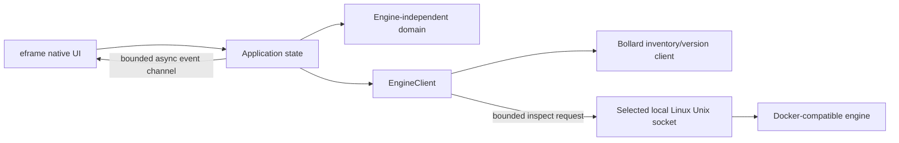

# Architecture overview

Ferrum keeps native presentation, engine-independent domain values, and Docker-compatible transport in separate workspace crates. The engine adapter uses Bollard for version negotiation and inventory requests; inspection uses a bounded, timed HTTP request over the selected local Linux Unix socket and an allowlisted internal DTO. The UI receives Ferrum-owned `ContainerSummary` and `ContainerDetails` values.

Connection, list, inspect, and context-discovery requests run in Tokio tasks.
Results arrive through a bounded channel; the worker requests a repaint after
delivery. The UI callback does not perform synchronous engine I/O. The
inventory request includes stopped containers. A successful empty response, a
connection failure, and an API failure remain distinct states.
Filtering and sorting operate on application-owned summary values; inspection
requests are issued on demand through the engine client. The UI receives typed
`ContainerDetails` rather than Bollard response objects. Inspect responses are
decoded only into an allowlisted DTO containing detail fields; environment
variables, labels, command arguments, and unrelated properties are ignored.
The inspect transport and JSON body are bounded and timed, and response contents
are never logged or included in errors. Optional fields remain absent when the
engine omits them.

The app owns a small Linux TOML settings store for the startup auto-connect
preference. See [Settings](../settings.md) for path selection, migration,
permissions, and persistence behavior. Docker context selection is session-only;
the engine crate invokes the Docker CLI with an argument array and exposes only
validated names, current status, and local-Unix versus unsupported transport.
Raw endpoint values are private and excluded from debug/UI output. A failed
context switch preserves the working connection and inventory.

## Current limits

The adapter is Linux-only. It preserves local `DOCKER_HOST` behavior and default
XDG/system socket discovery, and supports Docker CLI contexts backed by local
Unix sockets. Precedence is explicit `DOCKER_CONTEXT`, then `DOCKER_HOST`, then
the CLI current non-default context, then automatic discovery. Remote TCP/HTTP/
TLS/SSH contexts are unsupported and never downgraded. Podman context presence
does not establish Podman support.

The Linux local-context slice contributes to [issue #10](https://github.com/SzymonR1/ferrum-desktop/issues/10)
and does not close it: Podman/rootless validation and remote TLS/SSH policy
remain open. Windows named pipes and macOS are deferred to issue #21/M8. See
[issue #11](https://github.com/SzymonR1/ferrum-desktop/issues/11) and
[issue #21](https://github.com/SzymonR1/ferrum-desktop/issues/21).

See the [architecture decisions](decisions.md) for framework and transport tradeoffs.
