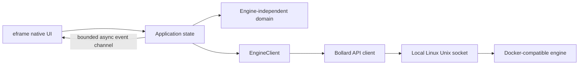

# Architecture overview

Ferrum keeps the native presentation, engine-independent domain values, and Docker-compatible transport in separate workspace crates. Only the engine adapter understands Bollard response types; the UI receives Ferrum-owned `ContainerSummary` values.

Connection and list requests run in a Tokio task. Results arrive through a bounded channel; the worker requests a repaint after delivery. The UI callback does not perform synchronous engine I/O. The inventory request includes stopped containers. A successful empty response, a connection failure, and an API failure remain distinct states.

## Current limits

The first adapter is Linux-only and uses local Unix sockets. It honors a local `DOCKER_HOST`; otherwise it tries the XDG runtime Docker socket and the conventional Docker socket. Windows/macOS engine support is deferred, while Docker contexts, remote transports, and Podman parity remain future work. See [issue #10](https://github.com/SzymonR1/ferrum-desktop/issues/10), [issue #11](https://github.com/SzymonR1/ferrum-desktop/issues/11), and [issue #21](https://github.com/SzymonR1/ferrum-desktop/issues/21).

See the [architecture decisions](decisions.md) for framework and transport tradeoffs.
