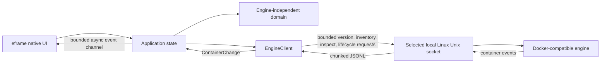

# Architecture overview

Ferrum keeps native presentation, engine-independent domain values, and Docker-compatible transport in separate workspace crates. The engine adapter uses a private Hyper/Hyperlocal request path over the selected local Linux Unix socket: version negotiation, inventory, and inspection use bounded JSON responses; lifecycle actions use status-only HTTP requests. The UI receives Ferrum-owned values rather than raw engine responses.

Connection, list, inspect, lifecycle, context-discovery, and event operations run
in Tokio tasks. Results arrive through the existing bounded channel; the worker
requests a repaint after delivery. Version, inventory, inspection, and
event-subscription setup requests use an 8-second timeout. Lifecycle requests
use a bounded 30-second timeout to allow the engine's graceful Stop/Restart
interval; timeout errors warn that a container may still be changing. Event
response bodies remain streaming and cancellable rather than using a
total-body timeout. Container-only JSONL events use a 64 KiB line cap and 1 MiB
data-frame cap. Processing is cancelled on context change or app teardown.
Each outage has up to three retries with 250 ms, 500 ms, and 1 s waits; a
successful subscription resets the budget. Exhaustion is surfaced as event
synchronization unavailable, while manual refresh remains available. Initial
and reconnect snapshots, plus successful manual refresh, re-inspect any open
container so state-gated controls do not remain stale. The UI callback performs
no synchronous engine I/O.

The inventory includes stopped containers. Filtering and sorting operate on
application-owned summary values; inspection requests are issued on demand.
Lifecycle actions are restricted to safe known states in the inspection dialog,
and Remove is explicitly confirmed. Lifecycle requests use the negotiated API
version; Start/Stop treat 304 as idempotent success, while other non-2xx statuses
become safe typed errors. Remove uses DELETE without force or volume-removal
parameters. Raw response bodies are never logged or exposed.

The app owns a small Linux TOML settings store for the startup auto-connect
preference. See [Settings](../settings.md) for path selection, migration,
permissions, and persistence behavior. Docker context selection is session-only;
the engine crate invokes the Docker CLI with an argument array and exposes only
validated names, current status, and local-Unix versus unsupported transport.
Raw endpoint values are private and excluded from debug/UI output. A failed
context switch preserves the working connection and inventory.

## Current limits

The adapter is Linux-only. It preserves local `DOCKER_HOST` behavior and default
XDG/system socket discovery, and supports Docker CLI contexts backed by local
Unix sockets. Precedence is explicit `DOCKER_CONTEXT`, then `DOCKER_HOST`, then
the CLI current non-default context, then automatic discovery. Remote TCP/HTTP/
TLS/SSH contexts are unsupported and never downgraded. Podman/rootless behavior
remains unvalidated.

The Linux local-context slice contributes to [issue #10](https://github.com/SzymonR1/ferrum-desktop/issues/10)
and does not close it. Windows named pipes and macOS are deferred to issue
[#21](https://github.com/SzymonR1/ferrum-desktop/issues/21) / M8. See
[issue #11](https://github.com/SzymonR1/ferrum-desktop/issues/11).

See the [architecture decisions](decisions.md) for framework and transport tradeoffs.
