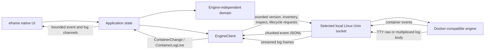

# Architecture overview

Ferrum keeps native presentation, engine-independent domain values, and Docker-compatible transport in separate workspace crates. The engine adapter uses a private Hyper/Hyperlocal request path over the selected local Linux Unix socket: version negotiation, inventory, and inspection use bounded JSON responses; lifecycle actions use status-only HTTP requests; logs use cancellable streaming response bodies. The UI receives Ferrum-owned values rather than raw engine responses.

Connection, list, inspect, lifecycle, context-discovery, and event operations run
in Tokio tasks. Results arrive through the existing bounded channel; the worker
requests a repaint after delivery. Version, inventory, inspection, and
event-subscription setup requests use an 8-second timeout. Lifecycle requests
use a bounded 30-second timeout to allow the engine's graceful Stop/Restart
interval; timeout errors warn that a container may still be changing. Event
response bodies remain streaming and cancellable rather than using a
total-body timeout. Container-only JSONL events use a 64 KiB line cap and 1 MiB
data-frame cap. Processing is cancelled on context change or app teardown.
Each outage has up to three retries with 250 ms, 500 ms, and 1 s waits; a
successful subscription resets the budget. Exhaustion is surfaced as event
synchronization unavailable, while manual refresh remains available. Initial
and reconnect snapshots, plus successful manual refresh, re-inspect any open
container so state-gated controls do not remain stale. The UI callback performs
no synchronous engine I/O.

Historical and followed container logs use a dedicated bounded 16-message
channel, separate from event delivery; the UI drains and batches messages.
Requests use the negotiated API version. Docker's log endpoint streams the
response body; TTY containers are decoded as raw combined data, while
non-TTY streams use Docker's 8-byte multiplex frames to preserve stdout/stderr.
The view is plain text, with a 1 MiB frame cap, 64 KiB line cap, and retention
of at most 8 MiB or 10,000 lines. It discards oldest lines with a visible count
and does not persist or log output. Follow retries request/stream failures at
most three times per Logs view session (250/500/1000 ms); replayed historical
lines do not renew the budget. Clean EOF ends without retry; after exhaustion,
manual Refresh starts a fresh bounded session. Reconnect reloads recent history
and clears buffered rows to avoid replay duplicates. Closing Logs or inspection,
context switch, or app teardown cancels log streaming.

The experimental embedded terminal uses Docker exec create/start with an
argument array and attached stdin/stdout/stderr in TTY mode, then upgrades the
HTTP/1.1 connection to a bidirectional stream over the selected local Unix
socket. Terminal resize uses the API-versioned exec resize endpoint. The
terminal view handles interactive input and terminal rendering; terminal bytes
are untrusted and never logged. OSC 52 clipboard and title requests are
ignored, while clipboard controls are user initiated. Closing the session
closes only its exec connection; it does not stop or remove the container.
This remains Linux local Docker-compatible Unix sockets only; issue #10 stays
open for Podman/rootless and remote compatibility.

The inventory includes stopped containers. Filtering and sorting operate on
application-owned summary values; inspection requests are issued on demand.
Lifecycle actions are restricted to safe known states in the inspection dialog,
and Remove is explicitly confirmed. Lifecycle requests use the negotiated API
version; Start/Stop treat 304 as idempotent success, while other non-2xx statuses
become safe typed errors. Remove uses DELETE without force or volume-removal
parameters. Raw response bodies are never logged or exposed.

The app owns a small Linux TOML settings store for the startup auto-connect
preference. See [Settings](../settings.md) for path selection, migration,
permissions, and persistence behavior. Docker context selection is session-only;
the engine crate invokes the Docker CLI with an argument array and exposes only
validated names, current status, and local-Unix versus unsupported transport.
Raw endpoint values are private and excluded from debug/UI output. A failed
context switch preserves the working connection and inventory.

## Current limits

The adapter is Linux-only. It preserves local `DOCKER_HOST` behavior and default
XDG/system socket discovery, and supports Docker CLI contexts backed by local
Unix sockets. Precedence is explicit `DOCKER_CONTEXT`, then `DOCKER_HOST`, then the
CLI current non-default context, then automatic discovery. Direct remote
`DOCKER_HOST` values and remote TCP/HTTP/HTTPS/SSH contexts are rejected without
local fallback. Podman/rootless behavior remains unvalidated.

The Linux local-context slice contributes to [issue #10](https://github.com/SzymonR1/ferrum-desktop/issues/10)
and does not close it. Windows named pipes and macOS are deferred to issue
[#21](https://github.com/SzymonR1/ferrum-desktop/issues/21) / M8. See
[issue #11](https://github.com/SzymonR1/ferrum-desktop/issues/11).

See the [architecture decisions](decisions.md) for framework and transport tradeoffs.
